<!-- ▶ HC ARCADE — Harsh Chaudhary's GitHub profile -->

  

  
  
  

  

  

  
  

  
  

  
  

⚔️ Boss 01 is live — <a href="https://www.aibattlearena.in"><b>play AI Battle Arena</b></a> · click any card to open the repo

  

    
    
  

  
  

  

  

  <picture>
    <source media="(prefers-color-scheme: dark)" srcset="https://raw.githubusercontent.com/HARSHCHAUDHARY04/HARSHCHAUDHARY04/output/github-snake-dark.svg" />
    <source media="(prefers-color-scheme: light)" srcset="https://raw.githubusercontent.com/HARSHCHAUDHARY04/HARSHCHAUDHARY04/output/github-snake.svg" />
    
  </picture>

  
  
  
  

  

